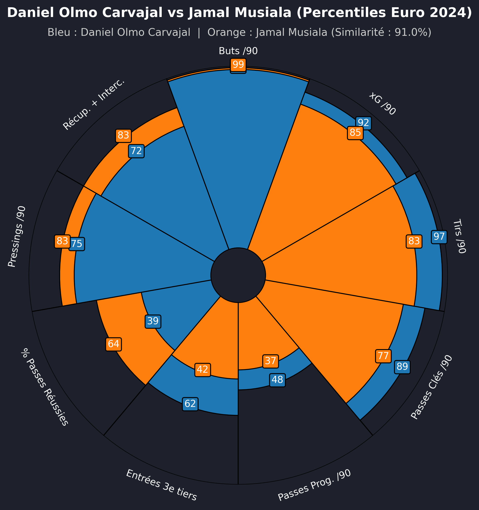

# Football Scouting — UEFA Euro 2024

Projet d’analyse footballistique réalisé à partir des données StatsBomb Open Data : préparation des événements, statistiques joueurs par 90 minutes, visualisations Python et rapport Power BI.

> Projet indépendant, non affilié à StatsBomb, Hudl ou l’UEFA. Les marques et données tierces restent la propriété de leurs ayants droit.

## Attribution des données

Données : [StatsBomb Open Data](https://github.com/hudl/open-data), Euro 2024 (competition 55, season 282).

## Aperçu

Le radar compare des percentiles calculés sur les joueurs ayant disputé au moins 270 minutes à l’Euro 2024. Les valeurs sont des percentiles, pas des statistiques brutes par 90 minutes.

## Contenu

- `notebooks/Football_Analysis.ipynb` : extraction et analyse dans Google Colab, création des tables DuckDB, calcul des statistiques et graphiques.
- `data/dim_matches.csv` : dimension matchs.
- `data/player_stats_per90.csv` : statistiques joueurs, joueurs ayant joué au moins 270 minutes.
- `data/shots_data.csv` : tirs hors penalties.
- `images/scouting_pizza_plot.png` : comparaison de profils en percentiles.
- `powerbi/Euro_2024_Dashboard.pbix` : rapport Power BI final à trois pages.
- `powerbi/theme_euro_2024.json` : thème Power BI personnalisé.
- `powerbi/README.md` : description des pages, actualisation des données et notes de publication.

## Démarrage

### Notebook

Ouvrir `notebooks/Football_Analysis.ipynb` dans Google Colab ou Jupyter. La première cellule installe les dépendances du notebook; la liste est également disponible dans `requirements.txt`. L’extraction interroge StatsBomb Open Data pour la compétition 55, saison 282 (Euro 2024); elle peut prendre plusieurs minutes selon le nombre de matchs et l’accès réseau.

Dans Colab, exécuter les cellules dans l’ordre. La dernière cellule utilise `google.colab.files` pour télécharger une archive; elle est propre à Colab. Les fichiers CSV de ce dépôt sont déjà exportés dans `data/`.

### Power BI Desktop

Le rapport est inclus dans `powerbi/Euro_2024_Dashboard.pbix`. Il comprend trois pages : analyse des équipes, scouting joueurs et analyse des matchs. Sur la page des matchs, les KPI présentent les matchs joués, les buts totaux, l’écart buts–xG et le taux de conversion; le graphique par phase montre les buts totaux sans séparer domicile et extérieur. Les titres sont centrés et les visuels de logo ont été retirés.

Le thème de couleurs est dans `powerbi/theme_euro_2024.json`. Pour actualiser les données sur une autre machine, utilisez les CSV du dossier `data/` et vérifiez les sources dans Power Query.

## Sources et attribution

Les données proviennent de [StatsBomb Open Data](https://github.com/hudl/open-data), compétition UEFA Euro 2024 (competition ID 55, season ID 282). Le dépôt StatsBomb demande de citer la source et d’utiliser son logo pour toute analyse publiée. Le logo est affiché dans la section Attribution ci-dessus. Consultez le dépôt et son accord d’utilisation avant toute redistribution ou réutilisation publique des données. Le fichier `data/` n’est pas couvert par une licence logicielle de ce projet.

Le logo EURO 2024 ne figure pas dans les fichiers de publication. Le PBIX inclus a été vérifié après suppression des visuels de logo. Le thème reprend uniquement une palette de couleurs. Consultez les consignes UEFA sur les marques EURO 2024 avant toute utilisation de marques ou visuels officiels.

## Licence

Aucune licence n’est encore attribuée au code de ce projet. Sans fichier `LICENSE`, les droits d’auteur restent réservés. Les données StatsBomb, le logo UEFA et les éventuelles marques tierces sont soumis à leurs propres conditions et ne sont pas couverts par une future licence du code.

